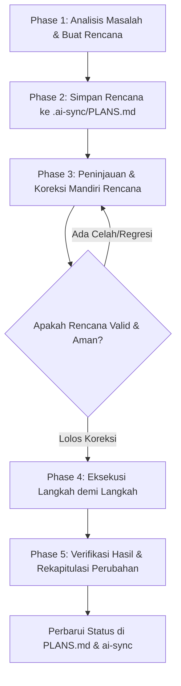

# Skill: Plan-Verify-Execute (Rencana - Koreksi - Eksekusi)

Skill ini adalah protokol operasional wajib bagi AI Agent di repositori VISTARA untuk memastikan setiap tindakan, perbaikan bug, atau penambahan fitur direncanakan secara eksplisit, didokumentasikan, diuji kelayakannya, dikoreksi sebelum dieksekusi, dan diverifikasi setelah selesai.

---

## 1. Prinsip Utama

1. **No Blind Action**: Jangan pernah langsung mengedit atau membuat kode tanpa merumuskan rencana langkah dan target masalah terlebih dahulu.
2. **Persistent Plan First**: Rencana kerja wajib disimpan secara persisten di berkas `.ai-sync/PLANS.md` sebelum file kode pertama diubah.
3. **Mandatory Pre-Execution Review**: Sebelum eksekusi dimulai, rencana wajib diinspeksi ulang dan dikoreksi (Self-Correction) guna mendeteksi potensi regresi, path yang salah, atau asumsi keliru.
4. **Methodical Execution**: Eksekusi perubahan dilakukan bertahap sesuai rencana yang telah dikoreksi.
5. **Verifikasi & Transparansi**: Setiap perbaikan wajib diverifikasi dengan build/test dan dilaporkan dengan format standar perubahan VISTARA.

---

## 2. Alur Kerja 5 Tahap (5-Phase Workflow)

Setiap kali menerima prompt perbaikan atau penambahan kode, agen wajib mengeksekusi 5 tahap berikut:



### Tahap 1: Analisis Masalah & Pembuatan Rencana Awal
- **Identifikasi Masalah**:
  - Apa masalah atau kebutuhan yang diminta pengguna?
  - Di mana masalah terjadi dan apa penyebab utamanya (*root cause*)?
- **Identifikasi Berkas Target**:
  - Sebutkan berkas yang akan dibuat, diubah, atau dihapus dengan tautan markdown `[nama_file](file:///path)`.
- **Rancangan Langkah Konkret (Step-by-Step Plan)**:
  - Buat daftar urutan langkah yang jelas dan spesifik (Langkah 1, Langkah 2, dst).

### Tahap 2: Simpan Rencana (Persistence)
- Buat entri baru pada berkas `d:/vscode/VISTARA/.ai-sync/PLANS.md` menggunakan format ID `PLAN-YYYY-MM-DD-XX`.
- Tetapkan status awal rencana sebagai `PROPOSED`.
- Jangan melakukan manipulasi kode sebelum entri ini tersimpan. Hal ini menjaga agar rencana tetap aman apabila percakapan terputus atau dialihkan ke model AI lain.

### Tahap 3: Peninjauan & Koreksi Mandiri Rencana (Pre-Execution Review)
Sebelum mengeksekusi langkah pertama, jalankan checklist koreksi mandiri:
1. **Verifikasi Keberadaan Berkas & Path**: Apakah semua file dan direktori yang dituju benar-benar ada dan tidak salah ketik?
2. **Audit Dampak & Regresi (Impact & Regression Analysis)**:
   - Apakah perubahan ini merusak komponen lain (Web React, Android Compose, Windows Scanner)?
   - Apakah ada type errors, broken imports, atau perubahan API kontraktual?
3. **Penyelarasan Arsitektur & Aturan Proyek**:
   - Apakah solusi mematuhi prinsip Clean Code?
   - Apakah perubahan UI mematuhi sistem tema visual (Atlas/Theme Factory)?
4. **Optimalisasi Langkah**:
   - Apakah ada langkah yang mubazir atau berisiko tinggi?
   - Apakah ada langkah mitigasi rollback bila terjadi kegagalan?
- **Catat Hasil Koreksi**: Perbaiki langkah-langkah rencana di `.ai-sync/PLANS.md` dan ubah status menjadi `CORRECTED & APPROVED`.

### Tahap 4: Eksekusi Bertahap (Execution)
- Ubah status rencana di `.ai-sync/PLANS.md` menjadi `IN_PROGRESS`.
- Jalankan langkah-langkah satu per satu menggunakan tool yang relevan (`replace_file_content`, `write_to_file`, `run_command`).
- Jika selama eksekusi muncul kendala tak terduga, hentikan sejenak, perbarui rencana di `.ai-sync/PLANS.md`, lalu lanjutkan.

### Tahap 5: Verifikasi Akhir & Rekapitulasi
1. **Verifikasi Teknis**:
   - Web: `npm run build` (memastikan zero compiler & type errors).
   - Python: Unit testing (`pytest` / `python -m unittest`) atau packaging script jika modul scanner disentuh.
   - Android: Build/lint check jika modul native disentuh.
2. **Perbarui Status Rencana**:
   - Ubah status rencana di `.ai-sync/PLANS.md` menjadi `COMPLETED`.
   - Perbarui `.ai-sync/TASKS.md`, `CHANGELOG.md`, `STATE.md`, dan `HANDOFF.md`.
3. **Format Laporan Wajib ke Pengguna**:
   - Tampilkan rekapitulasi singkat, padat, dan jelas:
     - **File / Komponen yang Diperbaiki**: Tautan file lengkap.
     - **Poin & Alasan Perbaikan**: Apa yang diubah dan rasionalisasinya.
     - **Hasil Verifikasi**: Konfirmasi hasil pengujian/build.

---

## 3. Templat Entri Rencana di `.ai-sync/PLANS.md`

```markdown
## PLAN-YYYY-MM-DD-XX | <Judul Singkat Tugas / Masalah>
- **Waktu**: YYYY-MM-DD HH:MM +07:00
- **Pemilik**: <vendor-model>
- **Status**: PROPOSED | CORRECTED & APPROVED | IN_PROGRESS | COMPLETED

### 1. Masalah & Kebutuhan (Problem Statement)
- **Gejala/Kebutuhan**: ...
- **Akar Masalah (Root Cause)**: ...

### 2. Komponen & Berkas Target
- [berkas1.ext](file:///d:/vscode/VISTARA/path/to/berkas1.ext)
- [berkas2.ext](file:///d:/vscode/VISTARA/path/to/berkas2.ext)

### 3. Rencana Langkah Awal (Initial Steps)
1. ...
2. ...

### 4. Koreksi & Ulasan Rencana Sebelum Eksekusi (Pre-Execution Review)
- **Audit Keberadaan Path**: OK / Diperbaiki ...
- **Audit Risiko Regresi**: OK / Diperbaiki ...
- **Hasil Koreksi**: ...

### 5. Langkah Final Terkoreksi (Final Verified Plan)
1. [ ] Langkah 1...
2. [ ] Langkah 2...

### 6. Hasil Eksekusi & Verifikasi
- Status pengujian: ...
- Rekapitulasi perubahan: ...
```

---

## 4. Pengecualian / Fast-Track (Tugas Trivial)
Untuk pertanyaan murni penjelasan (misal: "apa fungsi file X?"), pembuatan rencana formal di `.ai-sync/PLANS.md` tidak diwajibkan. Namun begitu pengguna meminta **modifikasi, perbaikan bug, refactoring, atau penambahan fitur**, protokol ini **WAJIB 100% DIJALANKAN TANPA PENGECUALIAN**.
